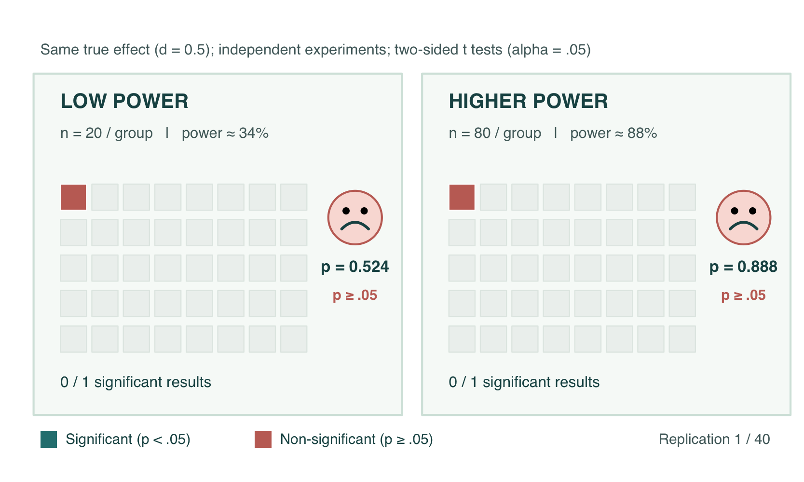

```{r}
#| label: setup
#| cache: false
#| include: false

library(tidyverse)

set.seed(666)

knitr::opts_chunk$set(
    dev = "png", fig.align = "center", fig.width = 10,
    fig.height = 5, out.width = "90%", dpi = 200
    )

ink <- "#1c5253"
sea <- "#287f80"
gold <- "#d99d42"
slate <- "#697987"
pale <- "#e8f2ef"

slide_theme <- function () {
    
    theme_minimal(base_family = "Open Sans", base_size = 16) +
        theme(
            plot.title = element_text(face = "bold"),
            panel.grid.minor = element_blank(),
            panel.grid.major.x = element_blank(),
            plot.margin = margin(10, 16, 8, 12),
            legend.position = "bottom"
            )
    
}
```

## Why should I care about statistical power?



::: {.takeaway}
Even when a real effect exists, a **low-powered study is unlikely to detect it reliably**. A priori power analysis helps us plan a study with a sufficient probability of achieving its goal, under explicit assumptions.
:::

# Why simulate statistical power?

## Power is a probability under an assumed model

In null-hypothesis significance testing (NHST), **statistical power** is the probability of rejecting the null hypothesis $\mathcal{H}_{0}$ when a specified alternative data-generating model $\mathcal{M}$ is true.

$$
\operatorname{Power}(n, \theta)
= \Pr\!\left(\text{reject } \mathcal{H}_{0} \mid n, \theta, \mathcal{M}\right).
$$

. . .

::: {.columns .metric-row}
::: {.column width="49%"}
<div class="metric">
  <span class="metric-label">False positive rate (Type I error):</span>
  <span class="metric-note">$\Pr(\text{reject }\mathcal{H}_0 \mid \mathcal{H}_0)$</span><br>
  <span class="metric-value">$\alpha$</span>
</div>
:::
::: {.column width="49%"}
<div class="metric">
  <span class="metric-label">True positive rate (Power):</span>
  <span class="metric-note">$\Pr(\text{reject }\mathcal{H}_0 \mid \mathcal{H}_1)$</span><br>
  <span class="metric-value">$1-\beta$</span>
</div>
:::
:::

::: {.columns .metric-row}
::: {.column width="49%"}
<div class="metric">
  <span class="metric-label">True negative rate:</span>
  <span class="metric-note">$\Pr(\text{fail to reject }\mathcal{H}_0 \mid \mathcal{H}_0)$</span><br>
  <span class="metric-value">$1-\alpha$</span>
</div>
:::
::: {.column width="49%"}
<div class="metric">
  <span class="metric-label">False negative rate (Type II error):</span>
  <span class="metric-note">$\Pr(\text{fail to reject }\mathcal{H}_0 \mid \mathcal{H}_1)$</span><br>
  <span class="metric-value">$\beta$</span>
</div>
:::
:::

. . .

::: {.takeaway}
**Important:** Power is conditional on the assumed effect, variability, design, analysis, and decision rule. It is not the probability that your hypothesis is true.
:::

## Power, in a broader sense

> Statistical power is the probability of attaining the goal of a planned empirical study, assuming a particular underlying state of the world.
>
> <span class="attribution">Adapted from Kruschke (2015), *Doing Bayesian Data Analysis*.</span>

The **goal** need not be $p<.05$:

::: {.incremental}
- Obtain $p<\alpha$ or a Bayes factor (BF) above a pre-specified threshold.
- Find a credible interval **entirely outside** a region of practical equivalence (ROPE).
- Find a credible interval **entirely inside** a ROPE.
- Achieve a pre-specified estimation precision (e.g., confidence/credible interval width).
:::

## Why use simulation?

::: {.columns .comparison-columns}
::: {.column width="49%"}

### Analytical calculations

- Fast and exact for many textbook designs.
- Convenient tools such as [G*Power](https://www.psychologie.hhu.de/arbeitsgruppen/allgemeine-psychologie-und-arbeitspsychologie/gpower).
- Less flexible when the design, statistical model, or success criterion changes.
:::
::: {.column width="49%"}

### Simulation-based planning

- Model the actual data-collection process.
- Fit the intended analysis to synthetic datasets.
- Define **any computable success criterion** and explore realistic nuisance parameters.
:::
:::

::: {.takeaway}
Simulation does not replace statistical assumptions; it makes them **explicit and testable**.
:::

## A general workflow

::: {.workflow}
1. **Specify** the data-generating model, plausible parameters, and sample sizes.
2. **Generate** one synthetic dataset.
3. **Analyse** it using the planned statistical model.
4. **Classify** the result according to the pre-specified goal.
5. **Repeat** and estimate the proportion of successful studies.
:::

$$
\widehat{\operatorname{Power}}(n,\theta)
=\frac{1}{R}\sum_{r=1}^{R}\mathbf{I}\{\text{goal attained in simulation }r\}.
$$

## Define the target before simulating

| Question | Example for a two-sample experiment |
|:--|:--|
| Data-generating model | Independent normal observations, equal variance |
| Design variable | $n$ participants **per group** |
| Assumed effect | Standardised mean difference $d=0.5$ |
| Analysis | Two-sided, equal-variance $t$ test |
| Decision criterion | $p<.05$ |
| Target success probability | At least 80% |

::: {.takeaway}
A sample size is only meaningful **relative to a particular set of assumptions and goals**.
:::

# Example 1 · Significance testing

## Step 1 · Simulate one experiment

For two independent groups, let $X\sim\mathcal N(0,1)$ and $Y\sim\mathcal N(d,1)$.

```{r}
#| label: function-simulate-p
#| echo: true
#| output: false

simulate_p <- function (n, d) {
    
    # we could also use rlnorm for simulating RTs, rbinom for accuracies, etc
    x <- rnorm(n, mean = 0, sd = 1)
    y <- rnorm(n, mean = d, sd = 1)
    
    t_results <- t.test(y, x, var.equal = TRUE)
    
    return (t_results$p.value)
    
}
```

Here, **`n` is the number of participants per group** and `d` is the population mean difference in standard-deviation units.

. . .

```{r}
#| label: one-experiment
#| echo: true

simulate_p(n = 36, d = 0.5)
```

::: {.takeaway}
One simulated $p$-value is one possible outcome, not an estimate of power.
:::

## Step 2 · Repeat the experiment

```{r}
#| label: estimate-power
#| echo: true

R <- 1e4
p_values <- replicate(n = R, expr = simulate_p(n = 36, d = 0.5) )
power_hat <- mean(p_values < 0.05)
mc_se <- sqrt(power_hat * (1 - power_hat) / R)

round(x = c(estimated_power = power_hat, MC_SE = mc_se), digits = 3)
```

$$
\widehat{\operatorname{Power}} =
\frac{\#\{p_r<.05\}}{R}
$$

Note: The Monte Carlo standard error quantifies **numerical uncertainty in the simulation estimate**, not uncertainty about the assumed population effect.

## Sanity check · Compare with analytical power

This simple design also has an analytical benchmark. A simulation implementation should reproduce it to within **Monte Carlo error**.

```{r}
#| label: check-analytical-power
#| echo: true

analytical_power <- power.t.test(
  n = 36, delta = 0.5, sd = 1, sig.level = 0.05,
  type = "two.sample", alternative = "two.sided"
  )$power

round(x = c(simulated = power_hat, analytical = analytical_power), digits = 3)
```

::: {.takeaway}
Use analytical solutions or small, independently checked special cases to **validate a new simulation function** before applying it to more complex designs.
:::

## The distribution of simulated $p$-values

```{r}
#| label: p-value-distribution
#| echo: false
#| fig-height: 5
#| fig-align: center

pdat <- data.frame(pvals = p_values)

pdat %>%
    ggplot(aes(pvals) ) +
    geom_histogram(binwidth = 0.02, boundary = 0, fill = sea, colour = "white", linewidth = 0.2) +
    annotate("rect", xmin = 0, xmax = 0.05, ymin = -Inf, ymax = Inf, fill = gold, alpha = 0.2) +
    geom_vline(xintercept = 0.05, colour = gold, linewidth = 1.2, linetype = "dashed") +
    annotate(
        "label", x = 0.13, y = Inf, label = "Reject H0: p < .05",
        vjust = 1.5, hjust = 0,
        size = 5, label.size = 0
        ) +
    labs(x = "p-value", y = "Number of simulated studies") +
    coord_cartesian(xlim = c(0, 1) ) +
    slide_theme()
```

## The distribution of simulated $p$-values

```{r}
#| label: p-value-distributions-by-effect
#| echo: false
#| fig-height: 5.5
#| fig-width: 11
#| out.width: "100%"
#| fig-align: center

# Simulation parameters
effect_sizes <- c(0.2, 0.4, 0.6, 0.8)
n_per_group <- 40
n_sims <- 10000
alpha <- 0.05

# Simulate p-values for each effect size
pdat <- purrr::map_dfr(effect_sizes, function (d) {

    # Theoretical power
    power <- power.t.test(
        n = n_per_group,
        delta = d,
        sd = 1,
        sig.level = alpha,
        type = "two.sample",
        alternative = "two.sided"
        )$power

    # Simulate t-statistics under the alternative
    df <- 2 * n_per_group - 2
    ncp <- d * sqrt(n_per_group / 2)

    t_values <- rt(n_sims, df = df, ncp = ncp)

    # Two-sided p-values
    p_values <- 2 * pt(-abs(t_values), df = df)

    data.frame(
        d = d,
        power = power,
        pvals = p_values,
        panel = sprintf("d = %.1f  |  Power = %.0f%%", d, 100 * power)
        )
    
})

# Preserve panel order
pdat$panel <- factor( pdat$panel, levels = unique(pdat$panel) )

# Plot
pdat %>%
    ggplot(aes(pvals) ) +
    geom_histogram(
        aes(fill = d),
        binwidth = 0.02,
        boundary = 0,
        colour = "white",
        fill = sea,
        linewidth = 0.2
        ) +
    annotate(
        "rect",
        xmin = 0,
        xmax = alpha,
        ymin = -Inf,
        ymax = Inf,
        fill = gold,
        alpha = 0.2
        ) +
    geom_vline(
        xintercept = alpha,
        colour = gold,
        linewidth = 1,
        linetype = "dashed"
        ) +
    scale_x_continuous(breaks = seq(0, 1, 0.25) ) +
    facet_wrap(
        ~ panel,
        ncol = 2,
        scales = "free_y"
        ) +
    coord_cartesian(xlim = c(0, 1) ) +
    labs(
        x = "p-value",
        y = "Number of simulated studies"
        ) +
    slide_theme() +
    theme(
        strip.text = element_text(
            size = 16,
            face = "bold"
            ),
        panel.spacing = grid::unit(1, "lines"),
        legend.position = "none"
        )
```

## Step 3 · Explore plausible sample sizes and effects

Generating every individual observation is intuitive, but a **vectorised equivalent** is faster for this specific model. Under equal variances, the test statistic follows a noncentral $t$ distribution:

$$
T\sim t_{2n-2}\!\left(\delta=d\sqrt{n/2}\right).
$$

```{r}
#| label: simulate-fast
#| echo: true

simulate_power_fast <- function (n, d, reps = 1e4, alpha = 0.05) {
    
    df <- 2 * n - 2
    t_draws <- rt(reps, df = df, ncp = d * sqrt(n / 2) )
    p <- 2 * pt(-abs(t_draws), df = df)
    
    return (mean(p < alpha) )
    
    }

power_grid <- expand.grid(
    n = seq(from = 20, to = 200, by = 20),
    d = seq(from = 0.1, to = 1, by = 0.1)
    )

power_grid$power <- mapply(
    simulate_power_fast, power_grid$n, power_grid$d,
    MoreArgs = list(reps = 1e4)
    )
```

::: notes
This faster method simulates sufficient test statistics, not full datasets. It is specifically valid here because the design is balanced, observations are normal, group variances are equal, and the planned analysis uses the pooled-variance t test. For complicated models, return to full data generation plus fitting.
:::

## The simulated power surface

```{r}
#| label: power-heatmap
#| fig-height: 6
#| fig-width: 12
#| fig-align: center

power_grid %>%
    ggplot(aes(x = n, y = d, fill = power) ) +
    geom_tile(width = 20, height = 0.1, colour = "white", linewidth = 0.2) +
    geom_contour(
        aes(z = power),
        breaks = 0.8,
        colour = "black",
        linewidth = 1,
        inherit.aes = TRUE
        ) +
    scale_fill_gradient(
        low = "#e5f0ed", high = ink,
        limits = c(0, 1), name = "Estimated power"
        ) +
    scale_x_continuous(breaks = seq(20, 200, 20), expand = c(0, 0) ) +
    scale_y_continuous(breaks = seq(0.1, 1, 0.1), expand = c(0, 0) ) +
    labs(x = "Sample size per group", y = "Standardised effect size (d)") +
    slide_theme() +
    theme(panel.grid.major.y = element_blank() ) +
    guides(
        fill = guide_colourbar(
            title.position = "top",
            title.hjust = 0.5,
            barwidth = grid::unit(10, "cm"),
            barheight = grid::unit(0.5, "cm")
            )
        )
```

<span class="small-note">Dark contour: approximately 80% power. Each cell is estimated from 10,000 simulated test statistics.</span>

## A different view: power curves

```{r}
#| label: power-curves
#| fig-width: 10
#| fig-height: 7.5
#| out.width: "70%"
#| fig-align: center

curves <- subset(power_grid, round(d, 1) %in% c(0.2, 0.4, 0.6, 0.8) )

curves$effect <- factor(
    sprintf("d = %.1f", curves$d),
    levels = c("d = 0.2", "d = 0.4", "d = 0.6", "d = 0.8")
    )

curves %>%
    ggplot(aes(n, power, colour = d, group = effect) ) +
    geom_hline(yintercept = 0.8, linewidth = 0.8, linetype = "dashed") +
    geom_line(linewidth = 1.5) +
    geom_point(size = 2.5) +
    scale_colour_gradientn(
        colours = c("#b9d2cd", "#81aba5", "#468886", "#1c5253"),
        limits = c(0.2, 0.8),
        breaks = c(0.2, 0.4, 0.6, 0.8),
        labels = c("0.2", "0.4", "0.6", "0.8"),
        name = "Assumed effect (d)",
        guide = guide_colourbar(
            title.position = "top",
            title.hjust = 0.5,
            barwidth = grid::unit(10, "cm"),
            barheight = grid::unit(0.5, "cm")
            )
        ) +
    scale_y_continuous(limits = c(0, 1), breaks = seq(0, 1, 0.2) ) +
    scale_x_continuous(breaks = seq(20, 200, 20) ) +
    labs(x = "Sample size per group", y = "Estimated power") +
    slide_theme()
```

::: {.takeaway}
Rather than selecting one optimistic effect size, examine a **range of scientifically plausible effects**.
:::

## How many simulation repetitions?

For $R$ approximately independent simulated studies, the Monte Carlo standard error is

$$
\mathrm{MCSE}\left(\widehat{p}\right)
\approx \sqrt{\frac{\widehat{p}(1-\widehat{p})}{R}}.
$$

When the estimated success probability is $0.80$:

| Number of simulations | MC standard error | Approximate 95% MC margin |
|--:|--:|--:|
| 1,000 | 0.013 | ±0.025 |
| 4,000 | 0.006 | ±0.012 |
| 10,000 | 0.004 | ±0.008 |

::: {.takeaway}
Increase $R$ until the Monte Carlo error is small **relative to the planning decision**. Report $R$, assumptions, and the simulation seed.
:::

# Example 2 · A Bayesian decision rule

## What if success is not "significant"?

The **region of practical equivalence (ROPE)** is a prespecified range of effects small enough to be considered practically negligible (see [Kruschke, 2018](https://doi.org/10.1177/2515245918771304)). Here, ROPE boundaries are −0.1 and +0.1.

```{r}
#| label: rope-diagram
#| echo: false
#| fig-height: 4.0

illustration <- data.frame(
    decision = factor(
        x = c("Inside ROPE", "Also inconclusive", "Inconclusive", "Outside ROPE"),
        levels = c("Outside ROPE", "Also inconclusive", "Inconclusive", "Inside ROPE")
        ),
    lower = c(-0.06, -0.18, 0.02, 0.26),
    upper = c(0.06, 0.16, 0.26, 0.49)
    )

illustration %>%
    ggplot(aes(y = decision) ) +
    annotate(
        "rect", xmin = -0.1, xmax = 0.1, ymin = -Inf, ymax = Inf,
        fill = pale, alpha = 1
        ) +
  geom_vline(
      xintercept = c(-0.1, 0.1), linetype = "dashed",
      colour = slate
      ) +
  geom_segment(
      aes(x = lower, xend = upper, yend = decision),
      colour = ink, linewidth = 2.5
      ) +
  geom_point(aes(x = (lower + upper) / 2), size = 4, colour = gold) +
  coord_cartesian(xlim = c(-0.35, 0.6) ) +
  labs(x = "Parameter value (illustrative 95% posterior intervals)", y = NULL) +
  slide_theme() +
  theme(panel.grid.major.y = element_blank() )
```

## Three outcomes, not a single "success" category

::: {.columns .comparison-columns}
::: {.column width="32%"}
<div class="decision decision-a"><h3>Inside</h3><p>The entire interval lies <strong>inside</strong> the ROPE.</p><p>Supports practical equivalence.</p></div>
:::
::: {.column width="32%"}
<div class="decision decision-b"><h3>Outside</h3><p>The entire interval lies <strong>outside</strong> the ROPE, on either side.</p><p>Supports a non-negligible effect.</p></div>
:::
::: {.column width="32%"}
<div class="decision decision-c"><h3>Overlapping</h3><p>The interval overlaps a ROPE boundary or spans the ROPE.</p><p>Inconclusive by this rule.</p></div>
:::
:::

::: {.takeaway}
**Decide what counts as success beforehand.** Power to find practical equivalence and power to exclude practical equivalence are *different* quantities.
:::

## Example: a $2\times2$ between-subject design

Let the parameter of interest be the interaction $\beta_{12}$.

$$
\begin{aligned}
y_i &\sim \mathcal N(\mu_i,\sigma^2), \\
\mu_i &= \alpha+\beta_1 x_{1i}+\beta_2 x_{2i}
        +\beta_{12}x_{1i}x_{2i}.
\end{aligned}
$$

**Illustrative assumptions**

- $n$ = **total** sample size, balanced across four cells.
- $\alpha=10$, $\beta_1=0.3$, $\beta_2=-0.5$, $\sigma=1$.
- Explore $\beta_{12}\in\{0,0.15,1.1\}$.

## Generate the factorial datasets

```{r}
#| label: factorial-generator
#| echo: true
#| output: false
simulate_factorial <- function (n, beta12, sigma = 1) {
    
    stopifnot(n %% 4 == 0)
    design <- expand.grid(x1 = c(0, 1), x2 = c(0, 1) )
    design <- design[rep(seq_len(nrow(design)), each = n / 4), ]
    mu <- 10 + 0.3 * design$x1 - 0.5 * design$x2 +
    beta12 * design$x1 * design$x2
    design$y <- rnorm(n, mean = mu, sd = sigma)
    
    return (design)
    
    }
```

```{r}
#| label: example-factorial
#| echo: true
#| output: false
example_data <- simulate_factorial(n = 80, beta12 = 1.1)
head(example_data, 4)
```

Here, $n=80$ means **20 observations per cell**.

## Posterior inference, without a costly MCMC loop

For a transparent teaching example, assume $\sigma=1$ is **known** and use independent normal priors on the regression coefficients. With a normal likelihood, the posterior is available analytically.

```{r}
#| label: posterior-function
#| echo: true
#| output: false
posterior_ci <- function (dat, sigma = 1) {
    
    X <- model.matrix(~ x1 * x2, data = dat)
    prior_mean <- c(10, 0, 0, 0)
    prior_prec <- diag(1 / c(25, 4, 4, 4)^2)
    post_cov <- solve(crossprod(X) / sigma^2 + prior_prec)
    post_mean <- post_cov %*% (
        crossprod(X, dat$y) / sigma^2 + prior_prec %*% prior_mean
        )
    k <- which(colnames(X) == "x1:x2")
    c(lower = as.numeric(post_mean[k] - 1.96 * sqrt(post_cov[k, k]) ),
    upper = as.numeric(post_mean[k] + 1.96 * sqrt(post_cov[k, k]) ) )
    
    }
```

<span class="small-note">Priors: intercept $\mathcal N(10,25^2)$; slopes $\mathcal N(0,4^2)$. The Gaussian 95% equal-tailed credible interval coincides with the 95% highest-density interval. For unknown $\sigma$ or hierarchical designs, fit the full Bayesian model instead.</span>

## Classify each posterior interval

```{r}
#| label: classify-rope
#| echo: true
#| output: false

classify_rope <- function (lower, upper, rope = c(-0.1, 0.1) ) {
    
    ifelse(
        lower >= rope[1] & upper <= rope[2], "Inside ROPE",
        ifelse(lower > rope[2] | upper < rope[1], "Outside ROPE", "Inconclusive")
        )
    
}
```

```{r}
#| label: evaluate-rope
#| echo: true
c(
    illustrative_interval = posterior_ci(example_data),
    decision = classify_rope(posterior_ci(example_data)[1], posterior_ci(example_data)[2])
    )
```

**Important:** An interval that excludes zero need not lie outside the entire ROPE. The two criteria are not interchangeable.

## Repeat for alternative true effects and sample sizes

```{r}
#| label: rope-repetitions
#| echo: true
#| output: false

reps <- 1e3 # 1,000 repetitions per cell

rope_results <- do.call(rbind, lapply(c(0, 0.15, 1.1), function (b) {
    do.call(rbind, lapply(seq(20, 200, by = 20), function (n) {
        intervals <- replicate(reps, posterior_ci(simulate_factorial(n, b) ) )
        data.frame(n = n, true_beta12 = b, lower = intervals[1, ], upper = intervals[2, ])
        }))
    }))

rope_results$decision <- classify_rope(rope_results$lower, rope_results$upper)
```

::: {.takeaway}
The code above simulates **three distinct underlying effects**. Each may produce different probabilities of equivalence, non-equivalence and an inconclusive result.
:::

## What does the decision procedure achieve?

```{r}
#| label: rope-results-plot
#| fig-height: 5
#| echo: false

rope_summary <- as.data.frame(with(rope_results, table(n, true_beta12, decision) ) )
names(rope_summary) <- c("n", "true_beta12", "decision", "frequency")
rope_summary$n <- as.numeric(as.character(rope_summary$n))

rope_summary$true_beta12 <- factor(
    rope_summary$true_beta12,
    levels = c("0", "0.15", "1.1"),
    labels = c("True interaction = 0", "True interaction = 0.15", "True interaction = 1.1")
    )

rope_summary$decision <- factor(
    rope_summary$decision,
    levels = c("Inside ROPE", "Inconclusive", "Outside ROPE")
    )

rope_summary %>%
    ggplot(aes(x = factor(n), y = frequency, fill = decision) ) +
    geom_col(position = "fill", width = 0.8) +
    facet_wrap(~ true_beta12, nrow = 1) +
    scale_fill_manual(
        values = c("Inside ROPE" = sea, "Inconclusive" = "#b9c5c9", "Outside ROPE" = gold)
        ) +
    scale_y_continuous(labels = function (x) paste0(round(100 * x), "%") ) +
    labs(
        x = "Total sample size (n)", y = "Proportion of decisions",
        fill = "Interval-based decision"
        ) +
    slide_theme() +
    theme(
        axis.text.x = element_text(angle = 45, hjust = 1),
        strip.text = element_text(face = "bold", size = 12),
        legend.position = "bottom"
        )
```

## Interpreting these results

- When the true interaction is **large** relative to the ROPE, increasing $n$ usually improves the chance of finding an interval wholly **outside** the ROPE.
- Near the ROPE, many intervals will remain **inconclusive**, even at moderate sample sizes.
- Demonstrating an effect is **practically equivalent to zero** can require much more precision than merely rejecting an exact-zero null.

::: {.takeaway}
A Bayesian success probability depends on the **prior, likelihood, decision criterion, assumed true parameters, and sample size**.
:::

# Example 3 · Planning for precision

## What if the aim is to get a useful estimate?

Instead of choosing $n$ to exceed a significance threshold, choose $n$ such that an uncertainty interval is **narrow enough to answer the scientific question**.

. . .

For example:

- Define the smallest effect size of interest (SESOI) or a ROPE.
- Specify the desired **confidence/credible interval width**.
- Choose a sample size that achieves this width with sufficiently high probability.

## Example: precision of a correlation estimate

For a correlation of $\rho=0.30$, the Fisher-$z$ approximation gives an illustrative interval width as $n$ grows. Analytical illustration using Fisher's transform; the assumed population correlation is 0.30 (see also [Schönbrodt & Perugini, 2013](https://doi.org/10.1016/j.jrp.2013.05.009)).

```{r}
#| label: correlation-precision
#| echo: false
#| fig-height: 5
#| out.width: "80%"

sizes <- seq(20, 700, by = 5)
rho <- 0.30
se_z <- 1 / sqrt(sizes - 3)
width <- tanh(atanh(rho) + 1.96 * se_z) - tanh(atanh(rho) - 1.96 * se_z)
precision_data <- data.frame(n = sizes, width = width)

precision_data %>%
    ggplot(aes(n, width) ) +
    geom_hline(yintercept = 0.2, linetype = "dashed", colour = gold, linewidth = 1.0) +
    geom_line(colour = ink, linewidth = 1.5) +
    annotate(
        geom = "label", x = 460, y = 0.25,
        label = "Illustrative target width = 0.20",
        colour = gold, size = 5
        ) +
    labs(x = "Total sample size (n)", y = "Approximate width of 95% correlation CI") +
    slide_theme()
```

::: notes
**Precision improves slowly with sample size:** halving the interval width requires approximately **four times as many observations**. Very stringent precision targets can therefore require extremely large samples.
:::

## A reproducible reporting check-list

::: {.workflow}
1. **Scientific goal:** effect detection, practical equivalence, or estimation precision?
2. **Model:** complete data-generating process and assumptions.
3. **Analysis:** exact estimator/model intended for the real data.
4. **Criterion:** explicit formula for declaring a successful study.
5. **Grid:** sample sizes and plausible parameter settings explored.
6. **Simulation quality:** repetitions, Monte Carlo error, seed, code and diagnostics.
:::

::: {.takeaway}
A trustworthy simulation-based power analysis is a **small, reproducible study about a planned study**.
:::

# Conclusions

## Take-home messages

::: {.incremental}
1. Power is **conditional** on a model, an effect, and a success criterion.
2. Simulation generalises sample-size planning to complex designs and non-NHST goals.
3. **Generate → analyse → classify → repeat** is the core algorithm.
4. Keep **evidence for equivalence** separate from **evidence against equivalence**.
5. Plan for **precision and robustness**, not merely a conventional threshold.
:::

```{r}
#| label: slides-qr
#| include: false

slides_url <- paste0(
    "https://github.com/lnalborczyk/",
    "IMSB2026/tree/main/slides"
    )

qrcode::generate_svg(
    qrcode = qrcode::qr_code(slides_url, ecl = "M"),
    filename = "figures/slides-qr.svg",
    size = 500,
    foreground = "#1c5253",
    background = "#ffffff",
    show = FALSE
    )
```

## Further resources

- [Kruschke (2015), *Doing Bayesian Data Analysis*](https://sites.google.com/site/doingbayesiandataanalysis/), especially the simulation-based planning chapter.
- [Kruschke (2018), *Rejecting or Accepting Parameter Values in Bayesian Estimation*](https://doi.org/10.1177/2515245918771304).
- [Schönbrodt & Perugini (2013), *At what sample size do correlations stabilize?*](https://doi.org/10.1016/j.jrp.2013.05.009)
- [Rothman & Greenland (2018), Planning study size based on precision rather than power](https://journals.lww.com/epidem/Fulltext/2018/09000/Planning_Study_Size_Based_on_Precision_Rather_Than.1.aspx).
- [The `precisely` R package](https://github.com/malcolmbarrett/precisely) and its [Shiny application](https://malcolmbarrett.shinyapps.io/precisely/).
- [Lakens, *Improving Your Statistical Inferences*](https://lakens.github.io/statistical_inferences/), especially the "Sample Size Justification" chapter.
- [Schönbrodt et al. (2017), Sequential hypothesis testing with Bayes factors: Efficiently testing mean differences](https://doi.org/10.1037/met0000061).
- [Beffara Bret, Beffara Bret, & Nalborczyk, L. (2021), A fully automated, transparent, reproducible, and blind protocol for sequential analyses](https://doi.org/10.15626/MP.2018.869).

## Thank you!

::: {.columns .contact-slide}
::: {.column width="58%"}

### Find me online

::: {.contact-links}

[ GitHub](https://github.com/lnalborczyk){.contact-link}

[ Bluesky](https://bsky.app/profile/lnalborczyk.bsky.social){.contact-link}

[ Personal website](https://lnalborczyk.github.io){.contact-link}

:::

:::
::: {.column width="38%"}

### Slides and code

[{.qr-code}](https://github.com/lnalborczyk/IMSB2026/tree/main/slides)

:::
:::
